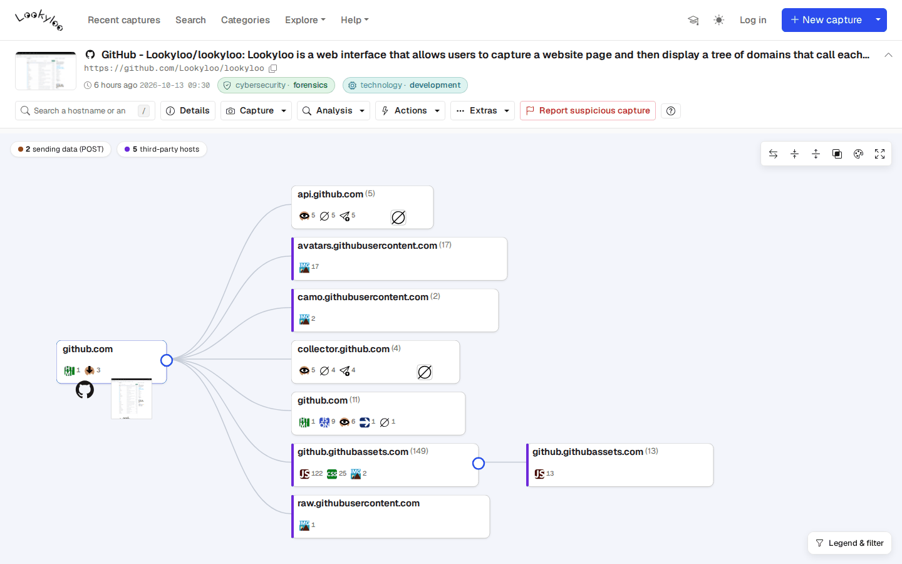
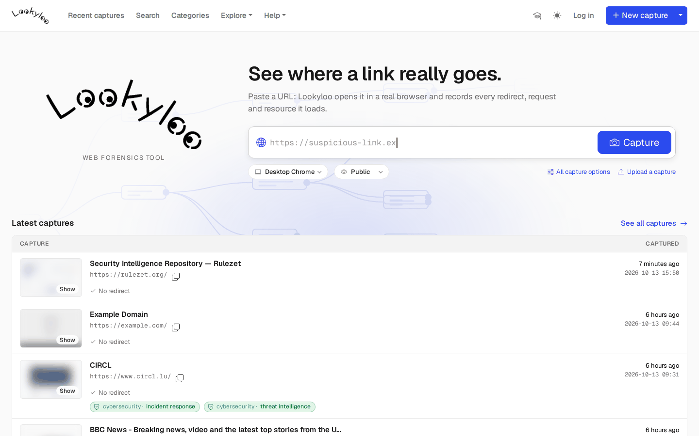
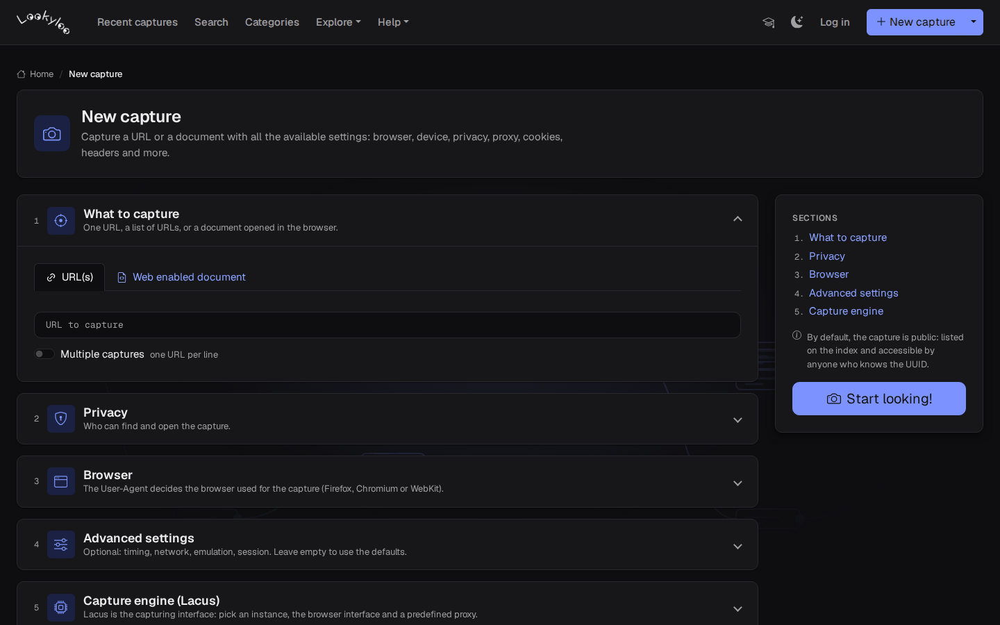
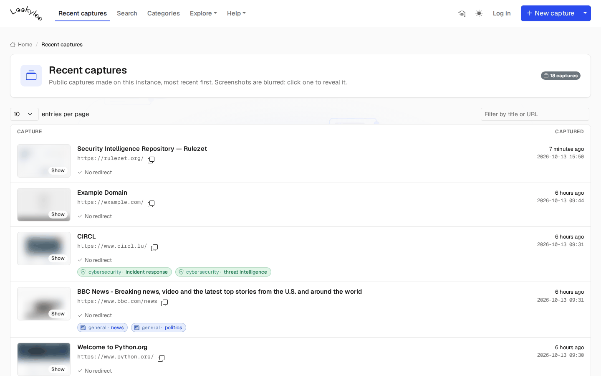
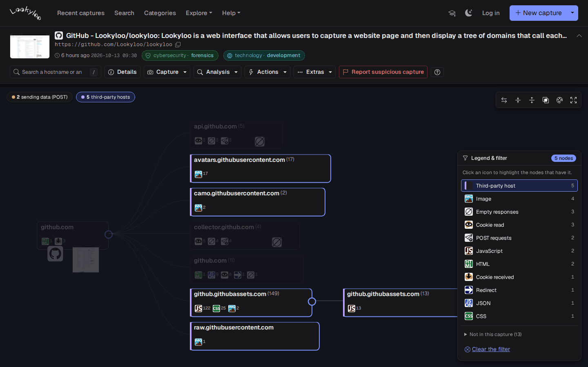
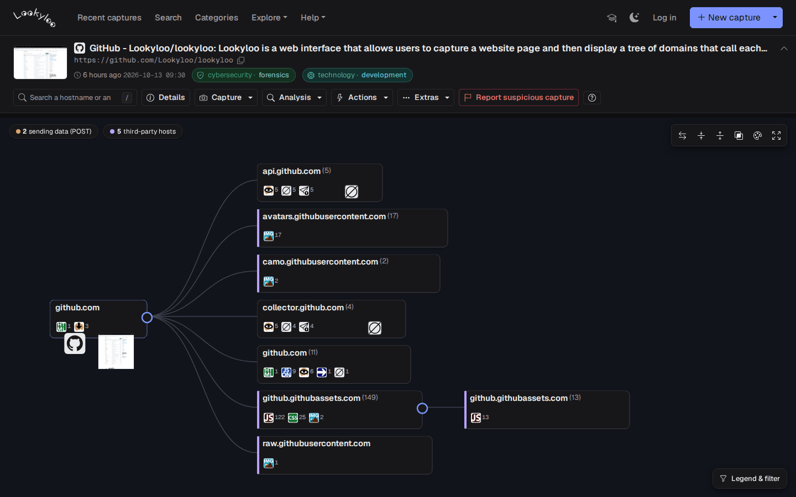
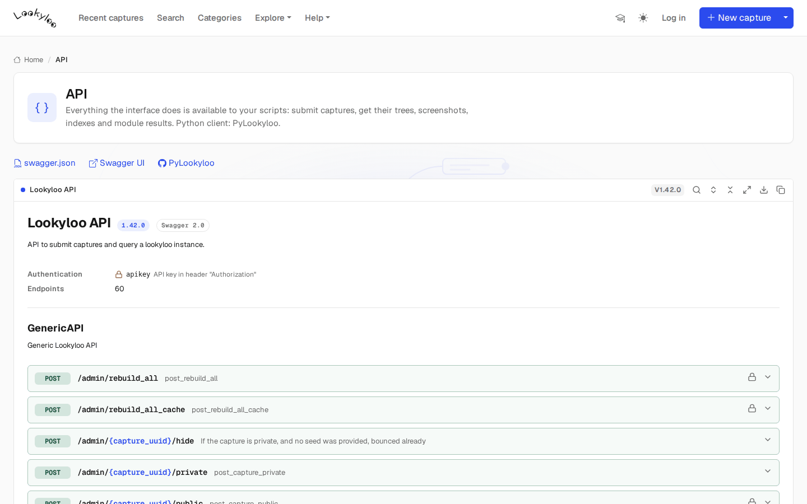

<div align="center">

<a href="https://www.lookyloo.eu/docs/main/index.html"></a>

### See where a link really goes.

*[Lookyloo](https://lookyloo.circl.lu/)* captures a web page in a real browser and shows
the tree of the domains and URLs that call each other.

[](https://lookyloo.circl.lu/)
[](https://www.lookyloo.eu/docs/main/index.html)
[](https://pypi.org/project/pylookyloo/)
[](LICENSE)
[](https://gitter.im/Lookyloo/community?utm_source=badge&utm_medium=badge&utm_campaign=pr-badge)

[What is Lookyloo?](#no-really-what-is-lookyloo) ·
[Interface](#the-interface) ·
[REST API](#rest-api) ·
[Install](#installation) ·
[Python client](#python-client) ·
[Contributing](#contributing-to-lookyloo) ·
[Support](#support)

</div>

<p align="center">
  
</p>

## No, really, what is Lookyloo?

You give Lookyloo a URL (or a document). It opens it in a real headless browser
([Lacus](https://github.com/ail-project/lacus) + Playwright), records **everything**
(HAR, screenshot, HTML, cookies, downloads, storage, console messages) and builds the
**tree of every redirect, request and resource** the page loaded. Third-party modules
(VirusTotal, MISP, Phishtank, urlscan, Pandora, …) enrich the capture, and every
hostname, IP, cookie, hash or favicon can be pivoted on to find the other captures
that share it.

- 🌳 **The tree** — follow the journey of a page: redirects, third parties, data sent (POST), mixed content.
- 🔎 **Analyse** — search and filter the tree by icon or text, view it from any node, highlight a node's neighbours, compare with another capture.
- 🔗 **Pivot** — hostnames, IPs, cookies, body hashes, favicons, HTTP headers hashes shared between captures.
- 📤 **Share** — MISP export, permalinks, private captures with a seed, report a suspicious capture.
- 🤖 **Automate** — everything the interface does is in the REST API and [PyLookyloo](https://github.com/Lookyloo/PyLookyloo).

Find all you need to know on the [documentation website](https://www.lookyloo.eu/docs/main/index.html).

## The interface

<table>
  <tr>
    <td width="50%"><br><b>Home</b> — paste a URL, see the latest captures.</td>
    <td width="50%"><br><b>New capture</b> — browser, device, privacy, proxy, cookies, headers…</td>
  </tr>
  <tr>
    <td><br><b>Recent captures</b> — searchable list, blurred screenshots.</td>
    <td><br><b>Legend &amp; filter</b> — highlight the nodes with a given icon.</td>
  </tr>
  <tr>
    <td><br><b>Dark mode</b> — and named themes, for every page.</td>
    <td><br><b>API</b> — the REST API, documented in the interface.</td>
  </tr>
</table>

Each page has an optional **tutorial** (graduation cap in the header) that walks
through its controls. Front-end notes for contributors: [`doc/ui/`](doc/ui/README.md).

<details>
<summary><b>What's in a name?!</b></summary>

```
Lookyloo ...

Same as Looky Lou; often spelled as Looky-loo (hyphen) or lookylou

1. A person who just comes to look.
2. A person who goes out of the way to look at people or something, often causing crowds and disruption.
3. A person who enjoys watching other people's misfortune. Oftentimes car onlookers that stare at a car accidents.

In L.A., usually the lookyloos cause more accidents by not paying full attention to what is ahead of them.
```
Source: [Urban Dictionary](https://www.urbandictionary.com/define.php?term=lookyloo)

</details>

# REST API

The API is self documented with swagger: browse it in the interface (**Help → API documentation**)
or play with it [on the demo instance](https://lookyloo.circl.lu/doc/).

# Installation

Please refer to the [install guide](https://www.lookyloo.eu/docs/main/install-lookyloo.html).

```bash
poetry install
poetry run update --init   # browsers, config validation, third-party JS/CSS/fonts/icons
poetry run start           # website on http://127.0.0.1:5100
```

# Python client

`pylookyloo` is the recommended client to interact with a Lookyloo instance.
It is available on PyPI:

```bash
pip install pylookyloo
```

For more details on `pylookyloo`, read the overview [docs](https://www.lookyloo.eu/docs/main/pylookyloo-overview.html), the [documentation](https://pylookyloo.readthedocs.io/en/latest/) of the module itself, or the code in this [GitHub repository](https://github.com/Lookyloo/PyLookyloo).

# Notes regarding using S3FS for storage

## Directory listing

TL;DR: it is slow.

If you have many captures (say more than 1000/day), and store captures in a s3fs bucket mounted with s3fs-fuse,
doing a directory listing in bash (`ls`) will most probably lock the I/O for every process
trying to access any file in the whole bucket. The same will be true if you access the
filesystem using python methods (`iterdir`, `scandir`...))

A workaround is to use the python s3fs module as it will not access the filesystem for listing directories.
You can configure the s3fs credentials in `config/generic.json` key `s3fs`.

**Warning**: this will not save you if you run `ls` on a directoy that contains *a lot* of captures.

## Versioning

By default, a MinIO bucket (backend for s3fs) will have versioning enabled, wich means it
keeps a copy of every version of every file you're storing. It becomes a problem if you have a lot of captures
as the index files are updated on every change, and the max amount of versions is 10.000.
So by the time you have > 10.000 captures in a directory, you'll get I/O errors when you try
to update the index file. And you absolutely do not care about that versioning in lookyloo.

To check if versioning is enabled (can be either enabled or suspended):

```
mc version info <alias_in_config>/<bucket>
```

The command below will suspend versioning:

```bash
mc version suspend <alias_in_config>/<bucket>
```

### I'm stuck, my file is raising I/O errors 

It will happen when your index was updated 10.000 times and versioning was enabled.

This is how to check you're in this situation: 

* Error message from bash (unhelpful):

```bash
$ (git::main) rm /path/to/lookyloo/archived_captures/Year/Month/Day/index
rm: cannot remove '/path/to/lookyloo/archived_captures/Year/Month/Day/index': Input/output error
```

* Check with python

```python
from lookyloo.default import get_config
import s3fs

s3fs_config = get_config('generic', 's3fs')
s3fs_client = s3fs.S3FileSystem(key=s3fs_config['config']['key'],
                                secret=s3fs_config['config']['secret'],
                                endpoint_url=s3fs_config['config']['endpoint_url'])

s3fs_bucket = s3fs_config['config']['bucket_name']
s3fs_client.rm_file(s3fs_bucket + '/Year/Month/Day/index')
```

* Error from python (somewhat more helpful):

```
OSError: [Errno 5] An error occurred (MaxVersionsExceeded) when calling the DeleteObject operation: You've exceeded the limit on the number of versions you can create on this object
```

* **Solution**: run this command to remove all older versions of the file 

```bash
mc rm --non-current --versions --recursive --force <alias_in_config>/<bucket>/Year/Month/Day/index
```

# Contributing to Lookyloo
To learn more about contributing to Lookyloo, see our [contributor guide](https://www.lookyloo.eu/docs/main/contributing.html).

### Code of Conduct
At Lookyloo, we pledge to act and interact in ways that contribute to an open, welcoming, diverse, inclusive, and healthy community. You can access our Code of Conduct [here](https://github.com/Lookyloo/lookyloo/blob/main/code_of_conduct.md) or on the [Lookyloo docs site](https://www.lookyloo.eu/docs/main/code-conduct.html).


# Support
 * To engage with the Lookyloo community contact us on [Gitter](https://gitter.im/lookyloo-app/community).
 * Let us know how we can improve Lookyloo by opening an [issue](https://github.com/Lookyloo/lookyloo/issues/new/choose).
 * Follow us on [Twitter](https://twitter.com/lookyloo_app).

### Security
To report vulnerabilities, see our [Security Policy](SECURITY.md).

### Credits
Thank you very much [Tech Blog @ willshouse.com](https://techblog.willshouse.com/2012/01/03/most-common-user-agents/) for the up-to-date list of UserAgents.

### License
See our [LICENSE](LICENSE).
